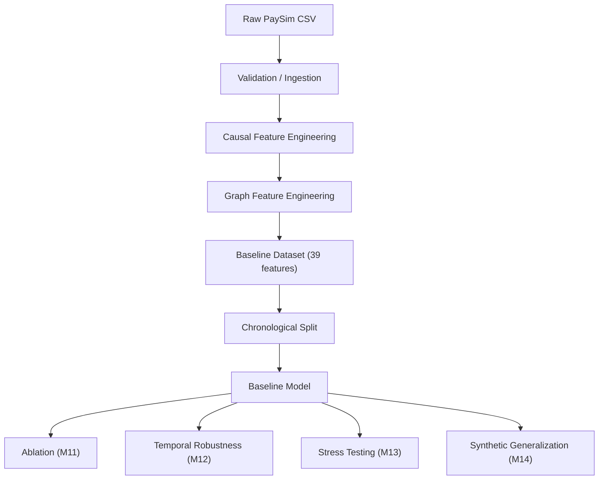

# FraudGraph AI

An explainable, leakage-aware fraud detection research pipeline built on the PaySim synthetic financial transaction dataset.

---

## Overview

FraudGraph AI is a research pipeline that investigates how far an explainable, strictly causal fraud-detection baseline can be trusted when it is trained and evaluated on a synthetic transaction log.

The project asks three connected questions:

1. **Can a leakage-safe baseline be built at full scale?** Every engineered feature is computed only from transactions that happened *before* the current one, and all preprocessing is fit on the training period only.
2. **What is the model actually learning?** Synthetic datasets contain generator artifacts. A model can score near-perfectly by learning the simulator's bookkeeping rather than anything that resembles fraud behavior. Much of this project is spent measuring that risk rather than assuming it away.
3. **Do graph-derived features add signal?** Fraud often involves relationships between accounts (fan-in, dual-role accounts, repeated counterparties), so causal account-graph features were designed, audited, and tested for measurable lift.

Temporal leakage matters because a fraud model is only ever used on transactions that occur after its training data. Random splits, or features computed with knowledge of later rows, produce evaluation numbers no deployed system could reproduce. Synthetic-dataset artifacts matter because they can make a model look far more capable than it is.

The project was built milestone by milestone. Each milestone produced a specification and machine-readable results in `reports/`, and each came with its own automated tests. Reproducibility, determinism, and honest reporting were treated as requirements throughout.

> **This is not a production fraud detector.** The headline baseline metrics are near-perfect, and later milestones show that this is almost entirely explained by a PaySim-specific balance pattern. See [Results](#results) and [Limitations](#limitations).

## Key capabilities

| Stage | Module | Milestone |
|---|---|---|
| PaySim ingestion and schema validation | `src/ingest.py` | M1 |
| Raw-data normalization and quality validation | `src/validate_raw_paysim.py` | M3 |
| Exploratory data analysis | `src/eda_raw_paysim.py` | M4 |
| Causal / raw tabular feature engineering | `src/features_raw_paysim.py` | M5 |
| Account-level transaction graph analysis | `src/graph_raw_paysim.py` | M6 |
| Causal graph-derived features | `src/graph_features_raw_paysim.py` | M7 |
| Baseline dataset assembly and feature audit | `src/baseline_dataset.py` | M8 |
| Chronological train/validation/test split design | `src/modeling_split.py` | M9 |
| Class-weighted logistic-regression baseline | `src/baseline_model.py` | M10 |
| Ablation and graph-feature contribution analysis | `src/ablation_analysis.py` | M11 |
| Temporal robustness analysis | `src/robustness_analysis.py` | M12 |
| Synthetic stress testing (fixed-model perturbation) | `src/stress_test_analysis.py` | M13 |
| Synthetic fraud-pattern generalization experiments | `src/synthetic_generalization.py` | M14 |

All stages are backed by an automated `unittest` suite (see [Testing](#testing)).

Graph features were **investigated** as a hypothesis. They did not measurably improve the baseline. This README reports that result plainly.

## Pipeline



Causal features are computed in one continuous streaming pass over the whole file. Running state is never reset at split boundaries. Rows are assigned to train, validation, or test only after their features have been computed.

## Dataset

The project uses **PaySim**, a *synthetic* mobile-money transaction log produced by an agent-based simulator. It is not real banking data and should not be read as representative of real customer behavior.

| Property | Value |
|---|---|
| Rows | 6,362,620 |
| Fraud rows | 8,213 (0.129%) |
| Simulated time | 743 hourly steps (days 0–30) |
| Fraud-bearing types | `CASH_OUT` (4,116) and `TRANSFER` (4,097) only |

Expected local path (not committed to Git):

```
data/raw/archive/paysim_orig/synthetic_financial_datasets_fraud_detection.csv
```

PaySim is distributed on Kaggle (originally `ntnu-testimon/paysim1`). Download it separately and place the CSV at the path above.

### PaySim-specific artifacts discovered

- **Balance bookkeeping inconsistencies.** Many rows, including legitimate ones, do not satisfy `newBalance = oldBalance ± amount`. Merchant destinations report zero balances by design.
- **Balance-draining fraud signature.** PaySim's fraud injection typically drains the origin account to exactly zero. Two derived features, `orig_balance_mismatch` and `orig_balance_after_zero`, capture this almost exactly.
- **Volume swings.** Fraud count is roughly flat (216–320 per day), while legitimate volume swings from 272 to 574,255 rows per day. This inflates fraud rates on several mid-simulation days.
- **Day 30 is a simulation-boundary artifact.** It contains 272 rows, and all 272 are fraud. It has no legitimate transactions, so it cannot be treated as a normal evaluation day. Precision, PR-AUC, and ROC-AUC are undefined or degenerate on it in isolation.
- **`isFlaggedFraud`** is PaySim's deliberately weak rule-based flag. It fires on only a tiny subset of actual fraud.

## Modeling methodology

### Chronological split (Milestone 9)

| Split | Days | Rows | Fraud |
|---|---|---|---|
| Train | 0–23 | 6,201,194 | 6,373 |
| Validation | 24–26 | 80,316 | 792 |
| Test | 27–30 | 81,110 | 1,048 |

- **Why not a naive tail-only test split?** Holding out only the final day (day 30) gives a test set that is 100% fraud (272 of 272 rows). False-positive behavior cannot be measured on it. It was documented as a counter-example and rejected.
- **Why not a random split?** It would train on rows that occur after test rows. It would also mix days with very different volume and fraud-rate regimes. Both are unrealistic for a system that only predicts the future.
- **Group-aware (account-level) splitting** was assessed and not implemented. 99.85% of origin accounts appear exactly once, so it would buy almost no additional protection.

### Features

- **39-column feature contract**: transaction attributes, balance-derived features, causal per-account identity aggregates, and 5 causal graph features.
- **Causal construction**: file and row order is event order. Within a shared `step`, an earlier row counts as prior. Every aggregate uses strictly prior rows only.
- **Never used as model inputs**: `isFraud` (the target), the identifiers `row_id`, `nameOrig`, and `nameDest`, and `step` / `day_index`.

### Preprocessing and model (Milestone 10)

- ±inf values are replaced with NaN.
- **Median imputation**: `SimpleImputer(strategy="median")`, fit on **train only**.
- **Standardization**: `StandardScaler()`, fit on **train only**.
- **Model**: `LogisticRegression(class_weight="balanced", C=1.0, solver="lbfgs", max_iter=1000, random_state=42)`.
- **Fixed decision settings**: a 0.5 threshold and a 1% alert budget, both fixed in source ahead of time.
- **No hyperparameter tuning**, no threshold tuning, and no resampling or SMOTE in the baseline milestone.
- **No test-set tuning**: the test split was never used for any model, preprocessing, threshold, or feature-selection decision.
- **Metrics**: PR-AUC is the primary metric. ROC-AUC is reported only as a secondary diagnostic. Confusion-matrix counts are reported alongside every rate.

## Results

### Baseline (Milestone 10, full 39-feature contract)

| Split | PR-AUC | Precision | Recall | TP | FP | FN |
|---|---|---|---|---|---|---|
| Validation | 1.0000 | 0.9975 | 1.0000 | 792 | 2 | 0 |
| Test | 1.0000 | 0.9990 | 1.0000 | 1,048 | 1 | 0 |

**These near-perfect metrics should not be read as evidence of real-world fraud-detection performance.**

The two largest coefficients belong to `orig_balance_mismatch` (−9.45) and `orig_balance_after_zero` (+9.01). Together they encode PaySim's own balance-draining fraud-generation pattern. What the baseline mostly shows is that a linear model can learn PaySim's synthetic tell.

### What the follow-up analyses showed

**M11: ablation (retrained models, feature groups varied).**

- Adding the 5 graph features to the tabular features produced **no measurable lift**. Test PR-AUC, precision, and recall were identical.
- Graph features on their own were weak: test PR-AUC 0.0171.
- Removing the two dominant balance features reduced test PR-AUC from 1.0000 to 0.8889. Test precision fell from 0.9990 to 0.2103, and false positives rose from 1 to 3,876.

| Test split | PR-AUC | Precision | Recall |
|---|---|---|---|
| `FULL_BASELINE` (39) | 1.0000 | 0.9990 | 1.0000 |
| `TABULAR_ONLY` (34) | 1.0000 | 0.9990 | 1.0000 |
| `GRAPH_ONLY` (5) | 0.0171 | 0.0172 | 0.6613 |
| `BALANCE_REDUCED_FULL` (37) | 0.8889 | 0.2103 | 0.9847 |

**M12: temporal robustness.** The dependency on the two balance features persists across every non-boundary test day. Days 27–29 score PR-AUC 1.0000 with the full baseline. The balance-reduced model scores PR-AUC 0.847–0.921 on those days, with precision 0.09–0.28. Day 30 is reported explicitly as a degenerate slice. Performance is consistent across `CASH_OUT` and `TRANSFER`.

**M13: synthetic stress testing (one fixed model, only test values perturbed).** The two features affect recall and precision differently:

- Neutralizing `orig_balance_mismatch` dropped recall from 1.0000 to 0.3569, while precision stayed high (0.9973).
- Neutralizing `orig_balance_after_zero` kept recall at 1.0000, but precision collapsed to 0.0284 (35,866 false positives).
- Progressive corruption of both features (0% to 100%) reduced recall monotonically, from 1.0000 to 0.3569.

**M14: synthetic fraud-pattern generalization (fixed model, 3,000 constructed rows per scenario).**

- A non-balance "fresh account" fraud heuristic, applied with both balance features neutralized, was flagged in **0 of 3,000** cases (recall 0.0000).
- With only `orig_balance_after_zero` neutralized, it was flagged in 221 of 3,000 cases (recall 0.0737).
- An altered balance-drain pattern (a 5% residual balance instead of exactly zero) was flagged in 0 of 3,000 cases.
- The legitimate-distractor scenario raised 0 alerts.

The fixed detector showed essentially no sensitivity to the tested non-balance heuristic.

Full figures are in `reports/*_specification.md`, `reports/*_results.json`, and the per-day and per-type CSVs.

## Graph features

Causal graph features were computed over an account-level directed transaction graph (origin → destination), using strictly prior rows only.

**Retained in the 39-column baseline contract:**

| Feature | Meaning |
|---|---|
| `origin_out_degree_causal` | Distinct destinations this origin has previously sent to |
| `dest_in_degree_causal` | Distinct origins that have previously sent to this destination |
| `origin_seen_as_dest_before_causal` | Origin has previously received money (dual-role signal) |
| `dest_seen_as_origin_before_causal` | Destination has previously sent money (dual-role signal) |
| `dest_incoming_concentration_causal` | Share of the destination's prior inflow from its single largest counterparty |

**Audited and excluded from the baseline contract:**

- `pair_seen_before_causal` and `pair_prior_count_causal` are exactly constant-zero across all 6,362,620 rows. PaySim contains no repeated origin→destination pairs.
- `origin_outgoing_concentration_causal` is 99.85% missing, and nearly always 1.0 when defined.

Because origins almost never repeat, the degree features closely track the per-account transaction counts from Milestone 5 in this dataset. Two-hop features were explored and deferred, since most nodes have 0–1 neighbors. In the baseline experiments, **graph features did not provide measurable lift**, and 3 of 5 graph coefficients changed sign across feature configurations.

## Testing

```bash
.venv/bin/python -m unittest discover -s tests -v
```

**388 tests**, all passing in the development environment (with the raw PaySim CSV present). Most tests run against small hand-built fixtures in `tests/fixtures/`. A few read the real raw CSV. In a fresh clone without the dataset, the suite reports 385 passed, 2 skipped, and 1 error: `test_fraud_confined_to_cash_out_and_transfer_on_real_dataset` in `tests/test_robustness_analysis.py` requires the CSV to be present.

Coverage includes:

- causal ordering, including same-step ties and decreasing-step detection
- split boundaries and day assignment
- chunk-size equivalence of streaming computations
- determinism
- target/identifier leakage and label independence
- feature contracts and column order
- train-only preprocessing
- robustness slicing and undefined-metric handling
- stress-perturbation and synthetic-generalization logic
- dataset integrity checks

## Resource usage

All analyses have been run repeatedly against the full 6,362,620-row dataset. Data is processed by streaming in chunks, and **no full processed feature table is ever materialized** in `data/processed/`. Train-split arrays are still held in memory for model fitting, so this is not a low-memory pipeline.

Observed peak RSS on full runs:

| Module | Peak RSS |
|---|---|
| Baseline model (M10) | ~7.0 GB |
| Ablation (M11) | ~7.9 GB |
| Robustness (M12) | ~7.9 GB |
| Stress testing (M13) | ~7.1 GB |
| Synthetic generalization (M14) | ~5.7 GB |

The largest runs approached, but stayed under, the project's 8 GB (8,000 MB) RSS safety limit. Plan for a machine with comfortably more than 8 GB of RAM.

## Repository structure

```
FraudGraph-AI/
├── src/                  # One module per milestone stage (see Key capabilities)
├── tests/                # unittest suite, one test module per src module
│   └── fixtures/         # Small hand-built PaySim-shaped CSVs
├── reports/              # Milestone specifications (.md), results (.json), per-day/type CSVs
├── data/
│   ├── raw/              # Place the PaySim CSV here (not committed)
│   └── processed/        # Intentionally empty; no feature table is materialized
├── requirements.txt
├── .gitignore
└── README.md
```

`reports/baseline_full_stream_audit.json` (~231 MB) is excluded from Git because it exceeds GitHub's file-size limit. It can be regenerated with `python -m src.baseline_dataset --full-stream`.

## Reproducibility

Developed with Python 3.11.9.

```bash
git clone https://github.com/Alien-dev-ai/FraudGraph-AI.git
cd FraudGraph-AI
python -m venv .venv
source .venv/bin/activate
pip install -r requirements.txt
```

Pinned dependencies: `pandas==3.0.5`, `numpy==2.4.6`, `scikit-learn==1.9.1`, `networkx==3.6.1`.

Place the PaySim CSV at `data/raw/archive/paysim_orig/synthetic_financial_datasets_fraud_detection.csv`, then run the tests:

```bash
.venv/bin/python -m unittest discover -s tests -v
```

Each milestone module has a command-line entry point. Every module accepts `--csv`. All except `src.ingest` default to the raw CSV path above, and most also accept `--chunksize`. **Modules that write reports overwrite their corresponding files in `reports/`.**

```bash
python -m src.ingest --csv data/raw/archive/paysim_orig/synthetic_financial_datasets_fraud_detection.csv  # M1
python -m src.validate_raw_paysim         # M3  quality report
python -m src.eda_raw_paysim              # M4  EDA
python -m src.features_raw_paysim         # M5  feature spec
python -m src.graph_raw_paysim            # M6  graph summary (default 2M-row cap)
python -m src.graph_features_raw_paysim   # M7  graph feature spec/summary
python -m src.baseline_dataset            # M8  (add --full-stream for the full audit)
python -m src.modeling_split              # M9  split design
python -m src.baseline_model              # M10 baseline (smoke test, then full run)
python -m src.ablation_analysis           # M11
python -m src.robustness_analysis         # M12
python -m src.stress_test_analysis        # M13
python -m src.synthetic_generalization    # M14
```

Modules M10–M14 run a bounded 300,000-row smoke test (`--smoke-rows`) before the full pass. `--max-rows` bounds the full run for testing. Random seeds are fixed (`random_state=42`).

## Limitations

1. **PaySim is synthetic.** It is generated by a simulator and does not represent real banking or payment behavior.
2. **The baseline's near-perfect performance is dominated by PaySim-specific balance bookkeeping** (`orig_balance_mismatch`, `orig_balance_after_zero`), not by general fraud-detection capability.
3. **Day 30 is a simulation-boundary artifact** (100% fraud, no legitimate rows). It is reported explicitly, but it cannot be evaluated as a normal day.
4. **Graph features showed weak standalone signal in this dataset.** PaySim has almost no repeated account relationships, which limits what relational features can capture.
5. **Synthetic stress and generalization experiments are not real-world validation.** They measure the model's sensitivity to the simulated fraud mechanism under specific, documented transformations.
6. **No claim of production readiness or real-world generalization is made.** Only one model family, one preprocessing configuration, and one fixed threshold were evaluated.
7. **External validation on real transaction data has not been performed.**

## Project status

**Milestones 1–14 are complete.** No later milestones have been started.

### Future work (not implemented)

- External validation on real or independently generated transaction data
- Stronger graph representations (e.g., temporal multi-hop or embedding-based) on data with richer relational structure
- Alternative model families, compared under the same leakage-safe protocol
- Calibrated alerting and alert-budget policy design
- Transaction-level explanations (per-alert attributions)
- Deployment architecture (streaming scoring, monitoring, drift detection)

## Author

[Alien-dev-ai](https://github.com/Alien-dev-ai)
